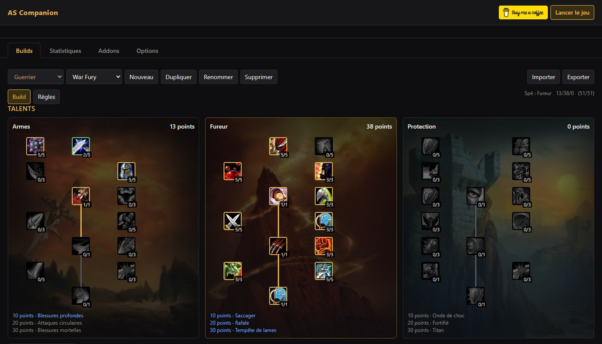
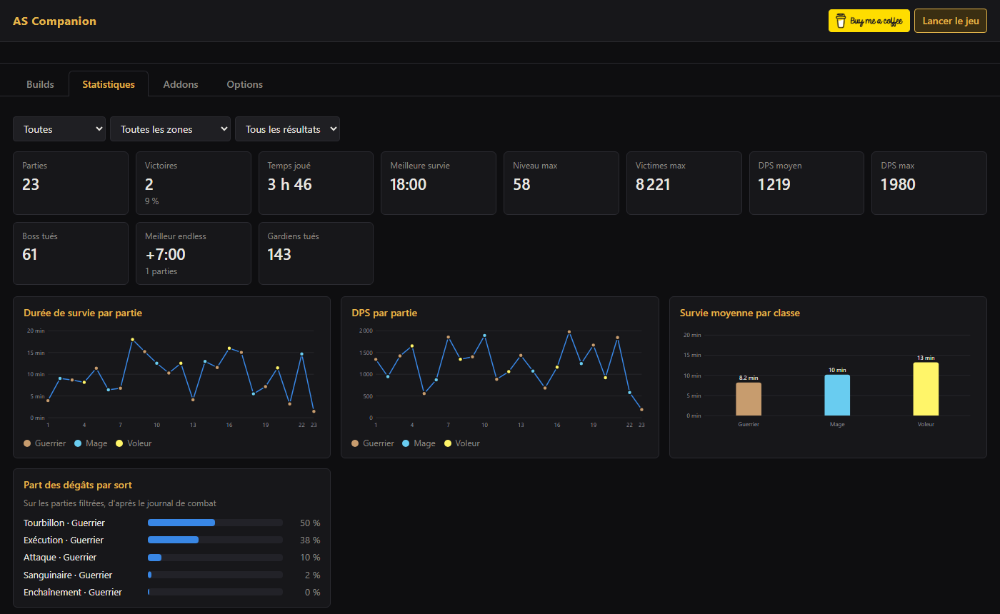
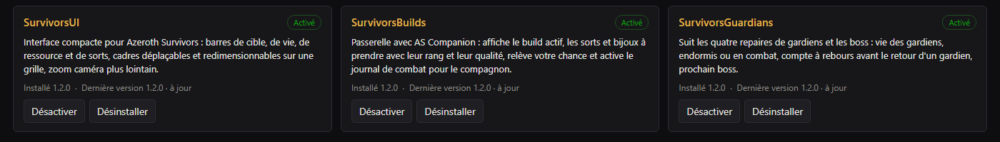
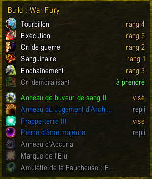
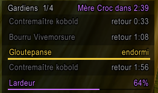

# Azeroth Survivors Companion

[English](README.md) · **Français**

Une application compagnon et trois addons pour [Azeroth Survivors](https://wow.aethus.pl/), le jeu de type survivors bâti sur un client WoW 1.12 réécrit.

Préparez votre build une fois, lancez le jeu depuis le compagnon, et laissez-le choisir les bonnes cartes de niveau pendant que vous jouez.

## Pour commencer

1. Téléchargez **[ASCompanion.exe](https://github.com/ZKYXYKZ/Azeroth-Survivor-Companion/releases/latest/download/ASCompanion.exe)**.
2. Placez-le dans le dossier du jeu, à côté de `AzerothSurvivors.exe`, et lancez-le. Il installe tout seul les addons au bon endroit. Ailleurs, ça marche aussi : il cherche alors le jeu, et vous demande où se trouve `AzerothSurvivors.exe` s'il ne le trouve pas.
3. Créez un build pour votre classe, puis cliquez sur **Lancer le jeu**.

C'est tout. Windows 10 ou 11, rien d'autre à installer. Le compagnon se tient à jour, lui et les addons.

> Au premier lancement, Windows peut afficher un avertissement SmartScreen, car l'application n'est pas signée : cliquez sur **Informations complémentaires**, puis **Exécuter quand même**. Chaque version est compilée depuis ce dépôt par GitHub Actions, et `SHA256SUMS.txt` permet de vérifier les fichiers.

## Ce qu'il fait

### Préparer vos builds

- **Talents** : les trois arbres de votre classe, comme dans le jeu.
- **Sorts** : votre ordre de priorité, un poids de 1 à 5 pour chacun, et les sorts dont vous ne voulez jamais. Une partie garde 6 sorts : les 6 premiers sont vos cibles, les suivants servent de repli.
- **Bijoux** : les anneaux, bijoux et amulettes que vous voulez, amulettes légendaires comprises, chacun avec un poids de 1 à 5. Survolez un bijou pour voir ses effets.
- **Règles** : le poids de la rareté, le nombre de relances à garder, le moment où accepter les bijoux de repli, et plus encore.
- **Partage** : exportez un build en une ligne de texte, importez celui d'un ami en un clic.

### Choisir les cartes à votre place

Lancez toujours le jeu avec **Lancer le jeu** : c'est ainsi que le compagnon voit les cartes de niveau.

- Un bandeau par-dessus le jeu indique la meilleure carte.
- Activez la **Sélection auto** dans Options, et le compagnon choisit et relance pour vous.
- Ses choix suivent la partie : sorts déjà pris et leur rang, dégâts réels de chaque sort, amulette portée, votre chance et les emplacements de bijoux encore libres. Les anneaux et bijoux ne se changent plus une fois pris : il les choisit avec soin.
- Il reconnaît votre spé au sort ou au familier que donne votre dernier talent en début de partie, et passe sur votre build de cette spé.
- Passer et Bannir n'ont pas encore de touche dans le jeu : ils restent manuels.

### Suivre vos parties

La page **Statistiques** enregistre chaque partie lancée depuis le compagnon, mode endless compris : durée de survie, niveau, victimes, DPS, boss et gardiens, avec des graphiques par partie, par classe, par spécialisation et par race, et la part des dégâts de chaque sort.

### Gérer les addons

La page **Addons** présente chaque addon avec son rôle, sa version, et des boutons pour l'installer, le mettre à jour, l'activer, le désactiver ou le désinstaller.

## Les addons

### SurvivorsBuilds

Affiche votre build à l'écran pendant la partie : les 6 sorts visés avec leur rang, les bijoux portés dans la couleur de leur qualité, et ce qui manque encore. Pendant le choix d'une carte, il rappelle quoi bannir et combien de relances il reste. Il suit votre spé comme le compagnon, et les flèches à côté de son titre passent à un autre de vos builds. En fin de partie, il enregistre le compteur de dégâts du jeu (familiers et effets compris) pour les statistiques du compagnon.

 

### SurvivorsUI

Une interface compacte pour ce mode de jeu : barres de cible, de vie, de ressource et de sorts réunies en bas, chat épuré, minicarte carrée et caméra qui recule plus loin. Chaque bloc se déplace et se redimensionne sur une grille.

### SurvivorsGuardians

Suit les quatre repaires de gardiens et les boss : vie des gardiens, en vie ou en combat, mort avec le compte à rebours avant son retour, et prochain boss. Un clic sur une ligne le cible.

 

Les trois partagent une fenêtre : le bouton doré **S** sur la minicarte, ou `/survivors`. Leurs panneaux se déplacent à la souris.

## Bon à savoir

- Builds, statistiques et réglages sont gardés dans `%APPDATA%\AS-Companion` : les mises à jour n'y touchent jamais.
- Fermer la fenêtre du compagnon l'arrête, sauf si une partie qu'il a lancée tourne encore.
- Le compagnon a besoin de Microsoft WebView2, intégré à Windows 10 et 11. S'il manque, le compagnon propose de l'installer.
- Un problème ? **Options → Rapport de bug** rassemble dans un zip le journal du compagnon, vos dernières parties et vos réglages : envoyez ce fichier avec une description.
- Vous préférez installer à la main ? Chaque version contient aussi `AzerothSurvivors-Addons.zip`, à extraire dans le dossier du jeu.

## Pour les développeurs

- Compiler le compagnon : `node tools/build-companion.js` (utilise le compilateur C# fourni avec Windows, sortie dans `dist\`).
- Publier une version : poussez un tag `vX.Y.Z`. GitHub Actions compile le compagnon, emballe les addons et publie la version.
- `NOTES.md` explique ce que le jeu expose et le fonctionnement de chaque partie.

## Avertissement

Projet de fan non officiel, sans lien avec Azeroth Survivors ni avec Blizzard Entertainment.

Développé par [ZKYXYKZ](https://x.com/zkyxykz).
