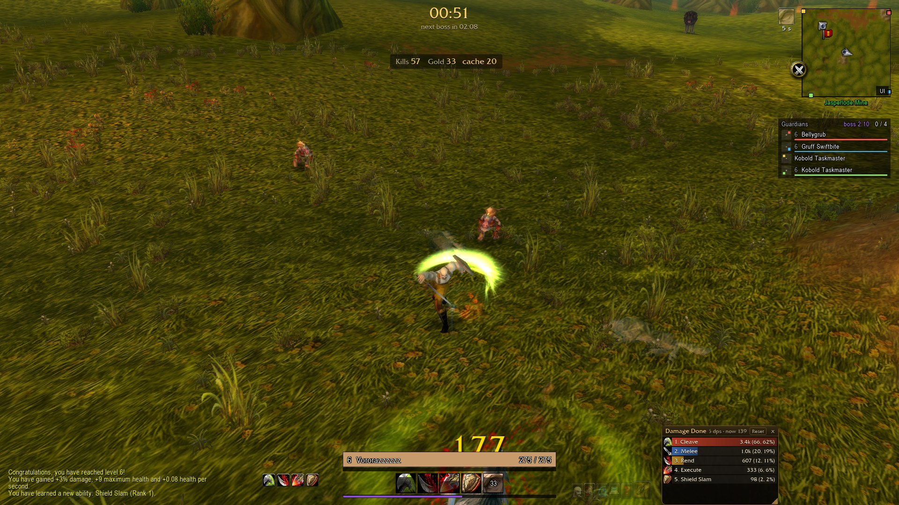
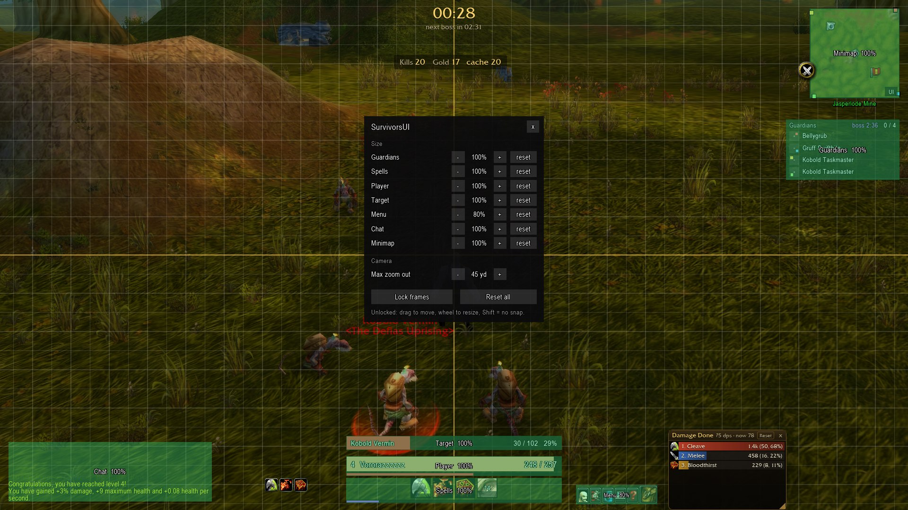

# AS-Addons

Addons for [Azeroth Survivors](https://wow.aethus.pl/), a survivors-style game built on a rewritten WoW 1.12 client: survive waves, level up, pick talents, loot gear, move on to harder maps.

The game loads regular WoW 1.12 addons (Lua 5.0, `## Interface: 11200`). These two are written for its game mode, where spells cast on their own and most of the stock interface is noise.

## Addons

### SurvivorsUI

A compact replacement for the stock interface.

- Bottom center block: target bar (name, health, percent), player health, resource, spell icons with cooldown sweep, experience bar.
- Stock player frame, target frame and action bars are hidden.
- Trimmed chat, square minimap with mouse wheel zoom.
- Micro buttons and backpack fade out until hovered.
- Settings panel: `UI` button on the minimap, or `/sui`.
  - Resize every block.
  - `Unlock frames` shows a grid: drag to move, mouse wheel to resize. Frames snap to each other, to the screen edges and center, and to the grid. Hold Shift to disable snapping.
  - Max camera zoom out, from 15 to 90 yards.

### SurvivorsGuardians

A tracker for the map guardians (mini bosses) and bosses.

- One row per guardian: compass dot (north is up), level, health once damaged.
- Dead guardians are greyed out, struck through and marked `DEAD`, with a respawn countdown once the delay has been measured.
- Colored pins on the minimap edge point to each living guardian.
- Bosses get their own row when they appear, and the header shows a countdown to the next one.
- Click a row to target that guardian or boss.
- Guardians are remembered per map, so the full list shows from the start of your next run there.
- `/guardians` resets the panel position, `/guardians peek` toggles the automatic level and health readout.

SurvivorsGuardians works on its own. With SurvivorsUI installed, its panel is moved and resized from the same settings.

## Install

1. In game, open Options, go to the AddOns tab and click `Open AddOns Folder`.
2. Copy the `SurvivorsUI` and `SurvivorsGuardians` folders into it.
3. Enable them in the AddOns list. They load at your next run.

## Known limits

- The run timer, the kill and gold counters, the damage meter and the native spell icon row are drawn by the game engine. Addons cannot move or hide them.
- The game only reveals a guardian on the map once you get close, so the first run on a map fills the list as you explore.
- The boss countdown is estimated from combat activity, since the game timer is not readable from Lua. Expect a few seconds of drift until the first boss appears.
- To read the level and health of distant guardians, the tracker targets each one for a fraction of a second, at most every 30 seconds, then restores your target.

## Notes for developers

`NOTES.md` (in French) documents what the game exposes to addons, how to run an isolated test instance, and how each addon works internally.

## Disclaimer

Unofficial fan project, not affiliated with Azeroth Survivors or with Blizzard Entertainment.
